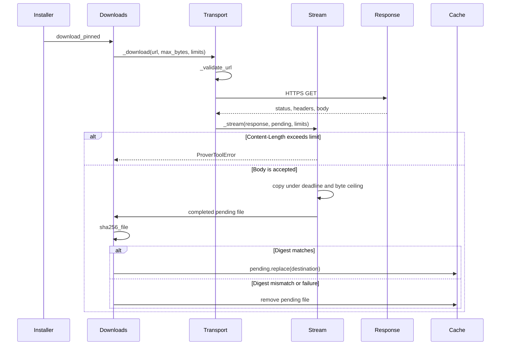
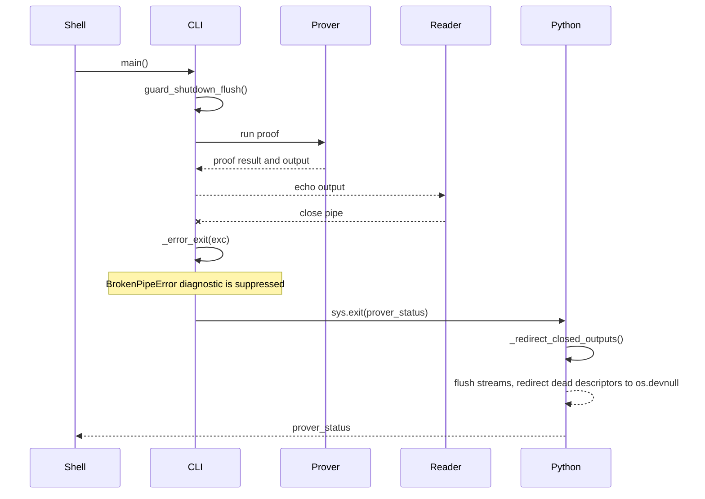

# Prover tools CLI design

## Context

The project now provides a Python package command named `prover-tools` to
replace four shell-script workflows used by Kani and Verus automation. The
command surface is intentionally small:

```plaintext
prover-tools kani install
prover-tools kani check-version
prover-tools kani exec --installation "$HOME/.kani/kani-0.67.0" \
  --cwd "$PWD" --extra-arg=list
prover-tools verus install
prover-tools verus run
```

`kani exec` requires a selected, already installed release. Its supported
platform, configuration, and trust constraints are documented in the
[users' guide](users-guide.md#explicit-legacy-kani-execution).

The implementation preserves the source scripts' externally observable
behaviour while moving command construction, validation, and test doubles into
typed Python modules.

## Architecture

`rust_prover_tools.cli` owns Cyclopts application construction and command
registration. Command functions are thin adapters: they construct option
dataclasses, delegate to feature modules, and translate expected errors to
process exit codes. Commands with a wide parameter table live in a dedicated
adapter module so the application module stays readable:
`rust_prover_tools.kani_exec_cli` for legacy Kani execution and
`rust_prover_tools.verus_run_cli` for `verus run`. An adapter module owns its
Cyclopts and environment-variable binding, output printing, and exit-code
mapping.

`rust_prover_tools.commands` is the only module that invokes external
programmes. It builds Cuprum `CommandSpec` values and returns a small
`CommandResult` containing standard output, standard error, and exit status.
Expected non-zero exits are translated to `CommandFailedError` by `run_checked`.

`rust_prover_tools.versions` contains pure parsing and pin-file helpers:
semantic-version validation, version extraction, checksum row lookup, and Verus
toolchain parsing.

`rust_prover_tools.kani` owns Kani installation and installed-version checks.
It keeps command strings shell-free by parsing overrides with `shlex.split`.
Installation defaults to the pinned prebuilt release and delegates to
`rust_prover_tools.kani_binary`, which extracts the frontend through
`rust_prover_tools.kani_archive`; `--compile` selects the older source build in
the same module.

`rust_prover_tools.z3` installs the pinned Z3 solver used by Verus. It
downloads the official release archive, extracts only the pinned `z3` binary,
and records a version marker so later runs reuse the installation.

`rust_prover_tools.binary_assets` is the manifest of pinned release artefacts:
names, HTTPS URLs, SHA-256 digests, per-asset byte ceilings, archive members,
and extraction ceilings. `rust_prover_tools.platforms` holds the shared Linux
x86_64 host check, and `rust_prover_tools.path_resolution` resolves optional
CLI paths against the repository root.

`rust_prover_tools.downloads` adds digest pinning and the atomic verified
store. HTTPS URL policy, including the rejection of embedded credentials, lives
in `rust_prover_tools.download_url`. Connection and redirect policy lives in
`rust_prover_tools.download_transport`, which accepts only HTTPS and follows a
bounded number of re-validated redirects. Body limits live in
`rust_prover_tools.download_stream`, which rejects an oversized
`Content-Length` before reading, counts streamed bytes, and enforces one
monotonic transfer deadline. A pending file is removed on any failure and
renamed to the final path only after the digest matches. The transport connects
directly over HTTPS and deliberately does not read proxy environment variables
such as `HTTPS_PROXY`. `download_pinned` exposes no transport hook, so a
proxy-only environment has no supported route through this library; a caller
that needs a proxy cannot be served by the current API.

`rust_prover_tools.observability` defines the opt-in event helper. The
downloader records `download.start`, `download.complete`, `download.cache_hit`,
`download.verified`, and `download.failed` with a bounded reason category
(`redirect_limit`, `redirect_target`, `redirect_location`, `http_status`,
`invalid_content_length`, `content_length`, `size_limit`, `deadline`,
`incomplete_body`, `stream_error`, `transport_error`, `digest_mismatch`,
`digest_read`, `store_error`, or `cleanup_error`). Each installer also records
`<tool>.install.start`, `<tool>.install.reuse`, `<tool>.install.complete`, and
`<tool>.install.failed` with a bounded phase, together with the extraction,
marker, setup, and verification boundaries (`z3.extract.complete`,
`z3.marker.recorded`, `kani.extract.complete`, `kani.setup.complete`,
`kani.verify.complete`, `verus.extract.start`, and `verus.extract.complete`).
When removing a temporary file fails while another failure is in flight, the
cleanup failure is recorded as `download.cleanup_failed` or
`<tool>.cleanup_failed` and the primary failure is preserved; a cleanup failure
on its own is reported as the download or installer failure instead. Kani names
its cleanup reasons explicitly: `cleanup_error` for a pending extraction file
that could not be removed, `rollback_error` for a backup that could not be
restored or a published executable that could not be removed during rollback,
and `backup_error` for a backup that could not be removed after both
executables were published. A `rollback_error` is always secondary to the
extraction failure it accompanies, so it is recorded and the extraction error
is re-raised. A `backup_error` is standalone: it is recorded and then raised, so
`kani.install.complete` is never reported. Completion events carry the
transferred byte count and the elapsed seconds. Records carry an `event_data`
mapping rather than free text. The library installs no handlers, so an
application opts in by lowering the level of the relevant `rust_prover_tools`
module logger. User-facing status lines and `ProverToolError` messages remain
the primary interface.

### Verified download sequence

Figure: the shared downloader bounds and verifies every archive before an
installer can use it.



`rust_prover_tools.verus` is a public package facade. Its implementation is
split into:

- `rust_prover_tools.verus.models`: dataclasses, constants, and path helpers.
- `rust_prover_tools.verus.install`: release archive download through the
  shared verified store, extraction, and directory normalization.
- `rust_prover_tools.verus.run`: binary resolution and toolchain management.
- `rust_prover_tools.verus.batch`: ordered per-file proof execution, partial
  failure reporting, and bounded telemetry.

## Command invocation

External commands are always invoked through Cuprum. The command catalogue is
created per command because the executable name is user-configurable for some
flows, especially `--kani-command` and `--verus-bin`. The catalogue still
declares the project name and developer documentation location so Cuprum error
messages can point maintainers at the internal command conventions.

The implementation does not use shell strings. User-provided command text is
converted into an argument vector with `shlex.split`, and every command is
executed as an argument vector.

## Cuprum version and echo policy

The project pins `cuprum==0.2.0b2` exactly, in `pyproject.toml`, and
`tests/workflow_contracts/test_cuprum_selection.py` holds the declared version,
the version `uv.lock` resolves, the requirement `uv.lock` records, and the
version installed in the test interpreter in agreement. The expected version is
read from `pyproject.toml`; the test holds no version literal, so a bump moves
every site together or fails naming the site that lagged.

An exact pin rather than a minimum version is deliberate. Cuprum 0.2 is a beta
whose prerelease line is still moving, and it changed `run_sync`'s signature
between 0.1.0 and 0.2.0b2: the `echo` and `capture` keywords became fields of
`RunOutputOptions`. Dependabot edits `pyproject.toml` and `uv.lock` and its
pull requests auto-merge, so a range would let an unreviewed later beta reach
this repository.

Cuprum 0.2 splits capture from echo. `run_command` builds a `RunOutputOptions`
whose `echo` mirrors the child's output to the parent's streams and whose
`broken_pipe_policy` is `BrokenPipePolicy.BEST_EFFORT`. The default policy,
`STRICT`, propagates `BrokenPipeError` out of `run_sync`; because echoed output
is the public CLI stream, its reader is often a pipe that closes early
(`| head`, a quit pager, a CI collector that has seen enough), and failing a
proof run whose proof had already succeeded would misreport it. `BEST_EFFORT`
stops echoing the affected stream and keeps capture, line observation, and
child reaping, so `CommandResult` still carries the output and the child's exit
status. Cuprum records the handled failure in `CommandResult.relay_fallbacks`;
`run_command` does not forward those to the caller because no prover workflow
acts on them.

Cuprum applies its `env` overlay to the parent environment rather than
replacing it, which is why `prepare_kani_command` builds a child dictionary
that is an overlay and lets inherited variables survive. `EnvMode.REPLACE`
exists in 0.2.0b2 for callers that need an exact environment, but it is
imported from `cuprum.context` rather than the package root, and no current
workflow needs it.

## Exit status under a closed pipe

`BEST_EFFORT` keeps the run alive after its reader leaves, which moves the
broken pipe from the echo path to the interpreter's shutdown. CPython flushes
`sys.stdout` on exit, and a failing flush overrides the status passed to
`sys.exit` with 120. For a command whose status is the proof result, that turns
both a passing and a failing proof into the same unreadable number.

`rust_prover_tools.exit_status.guard_shutdown_flush` installs an `atexit` hook
that flushes each stream while `BrokenPipeError` can still be caught and then
points the dead descriptor at the null device, the recipe in CPython's `signal`
module note on `SIGPIPE`. `cli.main` registers it before `sys.exit(app())`, so
the status the command computed is the status the process reports.

Both streams are guarded because `2>&1 | head` merges them onto one dead
descriptor, and CPython flushes `sys.stderr` at shutdown as well. Guarding only
`sys.stdout` leaves the combined redirect reporting 120, so the guard covers
the pair. CPython's final flush touches `sys.stdout` and `sys.stderr` whether
or not they have a file descriptor, so a dead stream that cannot be redirected
is replaced by a sink that discards output; leaving it installed would fail the
final flush and report 120 after all. The in-loop path needs the same care:
`_error_exit` writes the diagnostic before returning the prover's status, and
that write raises `BrokenPipeError` once the reader is gone. The diagnostic is
suppressed and the status is returned, because the status is the proof result
and the diagnostic is not. `exit_status.print_lines` follows the same rule for
the fallback warnings an unresolved `--verus-bin` produces: with an unbuffered
standard output that write happens while the command is still running, escapes
the shutdown guard, and without suppression would report a successful proof as
a failure. `kani_exec_cli.kani_exec` follows the same rule for the diagnostics
its two error branches emit, so a closed standard error cannot replace a Kani
verifier status with a traceback either.

Closed-pipe handling is observable without changing CLI output. Each handled
case emits one INFO event with the stream, phase, action and error category
when the host application enables logging; `print_lines` reuses that path for
the diagnostic `cli._error_exit` writes. The module installs no logger or
handler and attaches no output, path, command or exception text. A redirect
that cannot point the descriptor at the null device is recorded as a failed
action rather than raised from the shutdown hook, because an unhandled `atexit`
exception would only add noise. The dead stream is still replaced by the sink
in that branch: a redirect can fail while the stream is still flushed once more
at shutdown, so leaving it installed would reintroduce the status 120 the guard
exists to prevent.

The hook belongs at the entry point, not in the echo path. The echo path cannot
observe interpreter shutdown, and every command that writes to standard output
would meet the same 120 through a closed pipe.

For screen readers: The following sequence diagram traces a proof run whose
reader closes the pipe mid-stream. The CLI suppresses the diagnostic write that
would fail, exits with the prover's status, and the shutdown hook flushes the
dead streams so the interpreter reports that status instead of 120.



_Figure 1: Preserving the prover's exit status when the reader closes the pipe._

When `prover-tools --help` writes to a closed pipe, `rich` raises
`SystemExit(1)` from inside the help render through `Console.on_broken_pipe`,
which is its documented behaviour and a different question from preserving a
child's status. Bash normally reports `head`'s status, 0, for that pipeline;
enable `pipefail` or inspect `${PIPESTATUS[0]}` to read the producer's status.

## Test strategy

Unit tests cover pure helpers and command orchestration. They use cmd-mox to
intercept external commands on `PATH`, including `cargo`, `unzip`, and
`rustup`. Download tests replace the HTTPS connection with an in-memory
response so byte ceilings, deadlines, redirects, digest mismatches, and
pending-file cleanup are deterministic and never touch the network. Kani and Z3
tests build small local archives and stub only the verified-download step.
Verus install tests stub the same verified-download step and assert the pinned
asset request, so no network access or external downloader is involved.

Behavioural tests use `pytest-bdd` to verify public CLI scenarios for matching
and mismatched Kani versions, successful Verus proof execution, and missing
Verus toolchain reporting.

Snapshot tests use Syrupy for top-level CLI help output because the command
list, options, and formatting are part of the user interface.

End-to-end tests run the public Python module entry point with deterministic
fake Verus binaries. They do not download real Verus releases in the default
test suite.

Hypothesis property tests cover invariants in the pure helper layer, such as
valid semantic-version acceptance, supported Verus toolchain output forms,
Cargo backend-position classification, and profile-to-variable normalization.

## Decisions

The CLI is a package console script rather than a standalone file. This keeps
imports, test coverage, type checking, and linting inside the normal Python
package gates. The command inventory includes the additive `kani exec` route;
it does not replace the existing install and version-check commands.

The public interface is noun/verb based because it maps directly to the source
scripts while leaving space for future prover tools.

The implementation preserves legacy environment variables where source scripts
already exposed them, while also adding `INPUT_` bindings for GitHub
Actions-style configuration.

The Verus compatibility proof default is named `EXAMPLE_VERUS_PROOF_PATH` in
code. Callers should provide `--proof-file` for project-specific proof entry
points. `--proof-file` is repeatable and `VerusRunOptions.proof_files` carries
a tuple, because the predecessor shell wrapper iterated a proof-file array. An
empty tuple keeps the compatibility default, so the one-file form is unchanged.

Verus refuses more than one input filename per invocation, so a multi-file run
is a sequence of verifier invocations in the caller's order. `run_verus` checks
every path before the first invocation, then stops at the first non-zero exit.
The failure keeps `ProofFailureContext.proof_file` as the file that failed and
adds `proved_proof_files` for the files already verified, so a partial run
reports both halves of its result instead of collapsing to all-or-nothing. A
manifest or argfile was rejected: the predecessor accepted a list of paths, and
a repeatable flag covers that without inventing a file format. A path is
rendered unchanged in the failure report when it is printable and unambiguous;
a path containing a newline, a terminal control character, or the `", "` list
delimiter is quoted so it cannot spoof or split the diagnostic.

The batch and each invocation emit a start event followed by a completion
event, which gives log-based spans without a tracing dependency: a stalled
invocation is visible as an unmatched start. Only a genuinely stalled process
leaves that gap, because every other exit path, including an exception outside
the handled failures, closes the invocation span as `failure` / `unexpected`.
Completion events carry the proof ordinal and count, status class, exit code,
error category, and duration, and the batch completion adds the proved count.
Those bounded fields are the metric surface for a log pipeline (batch size,
invocation outcome, and invocation duration); no metrics client is installed.
Timings come from an injectable monotonic clock so tests can assert
deterministic durations. A batch that aborts outside the handled failure paths
reports `failure` / `unexpected` instead of a misleading success. The events
never carry proof paths, arguments, or verifier output, and the module installs
no logger or handler, so the CLI's normal stream is unchanged unless the host
application enables logging.

Binary discovery is split from installation at the API boundary.
`resolve_verus_bin` is the read-only probe that returns `None` when no
executable is found; `ensure_run_binary` owns the install fallback and is named
for that side effect.

The Verus run path carries the selected release target into installer fallback.
This keeps `prover-tools verus run --target <target>` aligned with
`prover-tools verus install --target <target>` when the default binary is
missing.

The Verus toolchain check treats a successful `verus --version` probe as
sufficient evidence that Verus is usable. `rustup` is only required when the
version probe fails with a parseable missing-toolchain message and automatic
toolchain installation is enabled.

The Verus installer keeps the original checksum validation and extraction
contract, but obtains its archive through the shared bounded HTTPS downloader
rather than `curl`. The pinned SHA-256 digest from `SHA256SUMS` becomes the
`PinnedAsset` digest, and the 2 GiB archive ceiling becomes its byte limit, so
the installer inherits the same redirect cap, deadline, streamed byte counting,
and atomic verified store as the Kani and Z3 installers. Because a repository
pin must not choose a local path, the archive is written under a fixed local
name and the version and target are validated as single safe path components.

Kani and Z3 binaries do not come from a user-managed checksum file. Their
pinned names, URLs, digests, and byte ceilings live in
`rust_prover_tools.binary_assets`, because these are fixed release artefacts
that every consumer must install identically. The downloader streams through a
pending file with a monotonic deadline and a byte ceiling rather than relying
on the server's declared length, and it removes that pending file on any
failure. Kani's prebuilt route is the default because a binary install is the
whole point of the shared tooling; `--compile` remains an explicit fallback for
hosts or versions the pinned release does not cover. Extraction is restricted
to named archive members with their own size ceilings, so a verified archive
still cannot write arbitrary paths.

## Operational notes

The Verus installer's final delete-and-move operation is not atomic. Concurrent
installations to the same target directory can race, so callers that share
install directories across processes must serialize access externally.

Default tests must remain deterministic. Real network downloads, real prover
installations, and long-running proof suites belong in opt-in integration jobs,
not the default `make test` gate.

## Explicit legacy release execution

The separate `kani exec` verb executes a selected complete release without
installing it, while leaving the proposed snapshot-only `kani run` programme in
[PR #131](https://github.com/leynos/rust-prover-tools/pull/131)
unchanged. The initial compatibility boundary is Linux x86_64 Kani 0.67.0 and
its exact release compiler metadata. Runtime lookup is child scoped; compiler
identity queries and subsequent Cargo compilation retain every configured
admission wrapper. Wrappers are optional when absent; the runtime does not
create a substitute on hosted runners. Environment and Cargo configuration
validation reject malformed selections and unproved backend or wrapper routes.

Profile backends are classified by position, not by name. Discovery returns a
`VerificationConfig` holding an immutable `BackendSelection` for each string
`profile.<name>.codegen-backend` found in Cargo configuration or an ancestor
workspace manifest. `prepare_kani_command` then sets
`CARGO_PROFILE_<NAME>_CODEGEN_BACKEND=llvm` for exactly those profiles in a
copied child mapping, leaving the caller's environment unchanged. Cargo gives
that variable precedence over both configuration files and manifest profiles,
so the selected release keeps compiling with its own backend. Profile names
must match `[A-Za-z0-9_-]+`; Cargo uppercases them and maps `-` to `_`, so two
spellings can share one variable and are pinned to the same value. The boolean
`[unstable] codegen-backend` flag only unlocks the profile option and selects
no profile, so it needs no override. A package-scoped
`profile.<name>.package.<package>` selection is refused because Cargo resolves
it above the profile variable, and an unresolved `include` is refused because
it hides inputs from validation. The override decision emits one
`backend_overrides` stage event on the `kani_release` logger, carrying the
selection, variable, and collision counts alongside the standard stage fields,
but no names or paths. It is emitted only when at least one profile is pinned,
so a repository that selects no backend logs no decision event.

The caller must trust the selected SDK and proof workspace, and keep their
files and Cargo configuration unchanged throughout the invocation, including
nested Cargo processes. Validation does not snapshot or lock those inputs,
authenticate SDK bytes, or make execution an untrusted-project sandbox. Cargo
build scripts and procedural macros execute normally with the caller's
permissions. The command itself does not install or copy assets or modify
global environment or services.

The SDK-child flag boundary also removes the exact bare LLVM coverage
instrumentation option and the bare `coverage` and `coverage_nightly` cfgs, in
joined or paired form. Cargo-llvm-cov's documented `--no-rustc-wrapper` mode
transports instrumentation through ambient flags, allowing this boundary to
isolate the SDK child while preserving parent measurement and configured
admission wrappers. The parent mapping remains unchanged. Similar cfg names,
valued cfgs, `trybuild_no_target` and other codegen options remain intact;
malformed paired cfg options fail explicitly. Parameterized instrumentation
options and older aliases are not guessed or silently removed.

This isolation cannot prevent a compiler wrapper from appending flags after
normalization. The default cargo-llvm-cov wrapper mode therefore remains
unqualified for nested Kani. Selecting ambient mode also changes coverage
selection semantics, so consumers must validate their measured report scope and
ratchet rather than assuming numeric equivalence.
