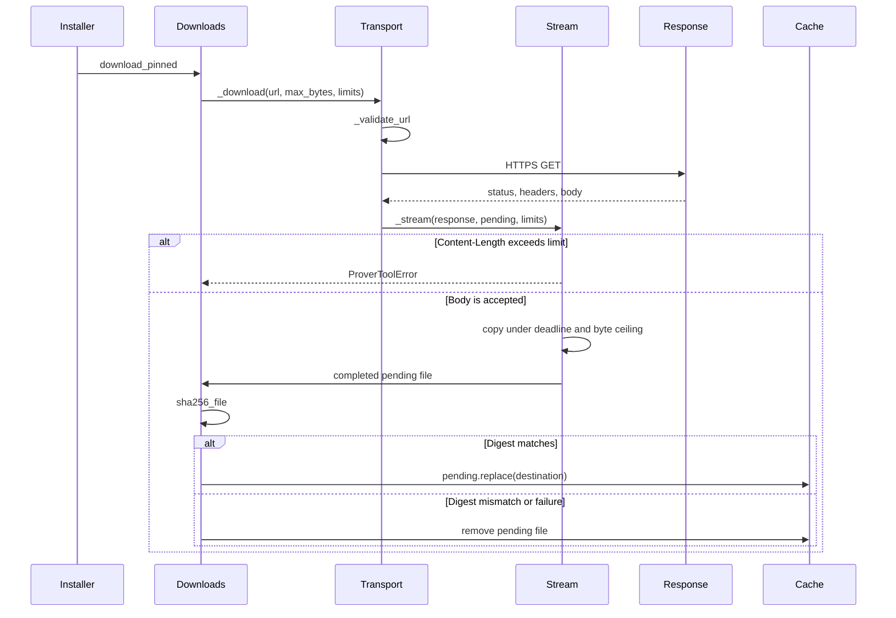
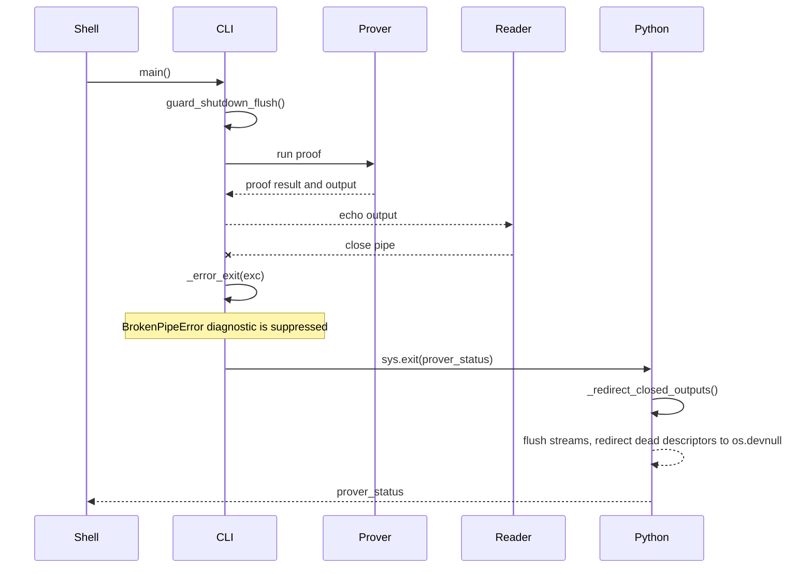

# Prover tools CLI design

## Context

The project now provides a Python package command named `prover-tools` to
replace four shell-script workflows used by Kani and Verus automation. The
command surface is intentionally small:

```plaintext
prover-tools kani install
prover-tools kani check-version
prover-tools kani exec --installation "$HOME/.kani/kani-0.67.0" \
  --cwd "$PWD" --extra-arg=list
prover-tools verus install
prover-tools verus run
```

`kani exec` requires a selected, already installed release. Its supported
platform, configuration, and trust constraints are documented in the
[users' guide](users-guide.md#explicit-legacy-kani-execution).

The implementation preserves the source scripts' externally observable
behaviour while moving command construction, validation, and test doubles into
typed Python modules.

## Architecture

`rust_prover_tools.cli` owns Cyclopts application construction and command
registration. Command functions are thin adapters: they construct option
dataclasses, delegate to feature modules, and translate expected errors to
process exit codes. Commands with a wide parameter table live in a dedicated
adapter module so the application module stays readable:
`rust_prover_tools.kani_exec_cli` for legacy Kani execution,
`rust_prover_tools.kani_snapshot_cli` for `kani snapshot install`,
`kani snapshot check` and `kani run`, `rust_prover_tools.verus_run_cli` for
`verus run`, `rust_prover_tools.kani_log_cli` for `kani analyse-log`, and
`rust_prover_tools.verus_log_cli` for `verus analyse-log`. An adapter module
owns its Cyclopts and environment-variable binding, output printing, and
exit-code mapping.

`rust_prover_tools.commands` is the only module that invokes external
programmes. It builds Cuprum `CommandSpec` values and returns a small
`CommandResult` containing standard output, standard error, and exit status.
Expected non-zero exits are translated to `CommandFailedError` by `run_checked`.

`rust_prover_tools.versions` contains pure parsing and pin-file helpers:
semantic-version validation, version extraction, checksum row lookup, and Verus
toolchain parsing.

`rust_prover_tools.kani` owns Kani installation and installed-version checks.
It keeps command strings shell-free by parsing overrides with `shlex.split`.
Installation defaults to the pinned prebuilt release and delegates to
`rust_prover_tools.kani_binary`, which extracts the frontend through
`rust_prover_tools.kani_archive`; `--compile` selects the older source build in
the same module.

`rust_prover_tools.z3` installs the pinned Z3 solver used by Verus. It
downloads the official release archive, extracts only the pinned `z3` binary,
and records a marker that binds the pinned version to the extracted binary's
SHA-256; the digest is computed while the member is streamed to disk. Reuse
rehashes the installed binary and accepts it only when the digest matches.
Marker parsing is strict: the file must be a JSON object with exactly the
`version` and `sha256` keys, both strings, the current version, and a
64-character lowercase hexadecimal digest. Any other content, including a
version-only marker from an earlier release, is a cache miss.
`rust_prover_tools.z3_selection` resolves a solver selection to one executable
and qualifies an observed version against the pin; it launches nothing, so the
`--version` probe stays at the CLI boundary described under
[solver selection](#solver-selection-for-verus-runs).

`rust_prover_tools.binary_assets` is the manifest of pinned release artefacts:
names, HTTPS URLs, SHA-256 digests, per-asset byte ceilings, archive members,
and extraction ceilings. `rust_prover_tools.platforms` holds the shared Linux
x86_64 host check, and `rust_prover_tools.path_resolution` resolves optional
CLI paths against the repository root.

`rust_prover_tools.downloads` adds digest pinning and the atomic verified
store. HTTPS URL policy, including the rejection of embedded credentials, lives
in `rust_prover_tools.download_url`. Connection and redirect policy lives in
`rust_prover_tools.download_transport`, which accepts only HTTPS and follows a
bounded number of re-validated redirects. Body limits live in
`rust_prover_tools.download_stream`, which rejects an oversized
`Content-Length` before reading, counts streamed bytes, and re-arms the socket
for each body read. `rust_prover_tools.download_deadline` owns the one shared
monotonic transfer budget and the socket watchdog that enforces it.

The deadline is a transport-wide boundary, not a stream-only rule. The
transport connects explicitly, refuses a hop whose budget the connect phase
spent, and re-arms the socket with the time the connect phase and the TLS
handshake left before the request is sent. It arms the watchdog with the
captured socket before the send, and the watchdog stays armed through the
header parse and the body, so a blocked send, a stalled header parse and a
stalled body read all fail at the deadline instead of waiting out a socket
timeout. A hop stops its watchdog before closing its connection, so a finished
hop cannot act on a later one.

Failures at or after the deadline are reported as the base deadline error,
while earlier ones keep their retry classification: an early transport failure
stays a transient `transport_error`, and a body shorter than its declared
`Content-Length` stays a transient `incomplete_body`, because a truncated
stream can end without a read error and a retry may deliver the whole body.
That includes an EOF at or after the deadline, since a socket the watchdog shut
down reads as end of stream. Digest, policy and local storage failures stay
outside the retry path. A pending file is removed on any failure and renamed to
the final path only after the digest matches. The transport connects directly
over HTTPS and deliberately does not read proxy environment variables such as
`HTTPS_PROXY`. `download_pinned` exposes no transport hook, so a proxy-only
environment has no supported route through this library; a caller that needs a
proxy cannot be served by the current API.

The deadline is not a hard wall-clock bound. DNS resolution has no socket
timeout, the standard library applies one connect budget to every resolved
address in turn and the initial TLS handshake reuses it, and local file I/O
while the body is written is not supervised. Digest verification, publication
and retries have their own bounds rather than sharing the transfer's. The
sections of `docs/developers-guide.md` and `docs/users-guide.md` that describe
the download deadline own the detailed account of these limits.

`rust_prover_tools.observability` defines the opt-in event helper. The
downloader records `download.start`, `download.complete`, `download.cache_hit`,
`download.verified`, and `download.failed` with a bounded reason category
(`redirect_limit`, `redirect_target`, `redirect_location`, `http_status`,
`invalid_content_length`, `content_length`, `size_limit`, `deadline`,
`incomplete_body`, `stream_error`, `transport_error`, `url_policy`,
`digest_mismatch`, `digest_read`, `store_error`, or `cleanup_error`). No
download event carries an asset name: callers supply it, so it is not a closed
category and would grow one metric label per manifest. The snapshot download
retry loop likewise records `download.retry` with only the failed attempt
number and the delay before the next attempt, so a transient failure is visible
without adding an unbounded reason or an asset-name label. Each installer also
records `<tool>.install.start`, `<tool>.install.reuse`,
`<tool>.install.complete`, and `<tool>.install.failed` with a bounded phase,
together with the extraction, marker, setup, and verification boundaries
(`z3.extract.complete`, `z3.marker.recorded`, `kani.extract.complete`,
`kani.setup.complete`, `kani.verify.complete`, `verus.extract.start`, and
`verus.extract.complete`). When a Z3 reuse is refused, `z3.install.cache_miss`
records one reason from a closed set (`binary_missing`, `not_executable`,
`marker_missing`, `marker_unusable`, or `digest_mismatch`) before the download
starts, so a reinstall is diagnosable without reading source; it carries no
digest, path, or marker text. Snapshot commands report timed spans as
correlated start and completion events. `kani.snapshot.install` closes with an
`outcome` of `activated` or `reused` and a `cache` of `miss` or `hit`;
`kani.snapshot.check` closes with `outcome="valid"`; and `kani.snapshot.run`
closes with an `outcome` of `success` or `failure` and the launcher's
`exit_code`. The internal `kani.snapshot.stage`, `kani.snapshot.setup`,
`kani.snapshot.probe`, `kani.snapshot.publish`, and `kani.snapshot.launch`
boundaries each report their own span, so a slow setup is distinguishable from
slow validation. Every closing event adds `elapsed_seconds`; a failure replaces
the completion with a `failed` event that names only the exception class as
`reason`. `kani.snapshot.install.repair` records a bounded repair trigger, and
`kani.install.staged` records the asset count. Those fields are the metric
source: `outcome`, `cache`, and `reason` are closed category sets,
`elapsed_seconds` is a duration, and `exit_code` is an integer, so no event
introduces an unbounded metric label. No event carries a path, URL, argument
list, digest, or payload. When removing a temporary file fails while another
failure is in flight, the cleanup failure is recorded as
`download.cleanup_failed` or `<tool>.cleanup_failed` and the primary failure is
preserved; a cleanup failure on its own is reported as the download or
installer failure instead. Kani names its cleanup reasons explicitly:
`cleanup_error` for a pending extraction file that could not be removed,
`rollback_error` for a backup that could not be restored or a published
executable that could not be removed during rollback, and `backup_error` for a
backup that could not be removed after both executables were published. A
`rollback_error` is always secondary to the extraction failure it accompanies,
so it is recorded and the extraction error is re-raised. A `backup_error` is
standalone: it is recorded and then raised, so `kani.install.complete` is never
reported. Completion events carry the transferred byte count and the elapsed
seconds. Records carry an `event_data` mapping rather than free text. The
library itself installs no handlers and exports no metrics client. The consumer
of the event stream is therefore the embedding application: whoever configures
logging for the process, such as the CLI's host or an operator-run harness,
lowers the level of the relevant `rust_prover_tools` module logger and attaches
the handler, which turns each `event_data` mapping into a log record or a
metric increment. Because every field that reaches that consumer is a closed
category (`outcome`, `cache`, `reason`, the retry `attempt`), a number
(`elapsed_seconds`, `exit_code`, `delay_seconds`, byte counts) or a log-only
identifier (`span_id`), the receiving side needs no per-release mapping.
User-facing status lines and `ProverToolError` messages remain the primary
interface.

### Verified download sequence

Figure: the shared downloader bounds and verifies every archive before an
installer can use it.



`rust_prover_tools.verus` is a public package facade. Its implementation is
split into:

- `rust_prover_tools.verus.models`: dataclasses, constants, and path helpers.
- `rust_prover_tools.verus.install`: release archive download through the
  shared verified store, extraction, and directory normalization.
- `rust_prover_tools.verus.run`: binary resolution and toolchain management.
- `rust_prover_tools.verus.batch`: ordered per-file proof execution, partial
  failure reporting, and bounded telemetry.

## Command invocation

External commands are always invoked through Cuprum. The command catalogue is
created per command because the executable name is user-configurable for some
flows, especially `--kani-command` and `--verus-bin`. The catalogue still
declares the project name and developer documentation location so Cuprum error
messages can point maintainers at the internal command conventions.

The implementation does not use shell strings. User-provided command text is
converted into an argument vector with `shlex.split`, and every command is
executed as an argument vector.

## Cuprum version and echo policy

The project pins `cuprum==0.2.0b2` exactly, in `pyproject.toml`, and
`tests/workflow_contracts/test_cuprum_selection.py` holds the declared version,
the version `uv.lock` resolves, the requirement `uv.lock` records, and the
version installed in the test interpreter in agreement. The expected version is
read from `pyproject.toml`; the test holds no version literal, so a bump moves
every site together or fails naming the site that lagged.

An exact pin rather than a minimum version is deliberate. Cuprum 0.2 is a beta
whose prerelease line is still moving, and it changed `run_sync`'s signature
between 0.1.0 and 0.2.0b2: the `echo` and `capture` keywords became fields of
`RunOutputOptions`. Dependabot edits `pyproject.toml` and `uv.lock` and its
pull requests auto-merge, so a range would let an unreviewed later beta reach
this repository.

Cuprum 0.2 splits capture from echo. `run_command` builds a `RunOutputOptions`
whose `echo` mirrors the child's output to the parent's streams and whose
`broken_pipe_policy` is `BrokenPipePolicy.BEST_EFFORT`. The default policy,
`STRICT`, propagates `BrokenPipeError` out of `run_sync`; because echoed output
is the public CLI stream, its reader is often a pipe that closes early
(`| head`, a quit pager, a CI collector that has seen enough), and failing a
proof run whose proof had already succeeded would misreport it. `BEST_EFFORT`
stops echoing the affected stream and keeps capture, line observation, and
child reaping, so `CommandResult` still carries the output and the child's exit
status. Cuprum records the handled failure in `CommandResult.relay_fallbacks`;
`run_command` does not forward those to the caller because no prover workflow
acts on them.

Cuprum applies its `env` overlay to the parent environment rather than
replacing it, which is why `prepare_kani_command` builds a child dictionary
that is an overlay and lets inherited variables survive. `EnvMode.REPLACE`
exists in 0.2.0b2 for callers that need an exact environment, but it is
imported from `cuprum.context` rather than the package root, and no current
workflow needs it.

## Exit status under a closed pipe

`BEST_EFFORT` keeps the run alive after its reader leaves, which moves the
broken pipe from the echo path to the interpreter's shutdown. CPython flushes
`sys.stdout` on exit, and a failing flush overrides the status passed to
`sys.exit` with 120. For a command whose status is the proof result, that turns
both a passing and a failing proof into the same unreadable number.

`rust_prover_tools.exit_status.guard_shutdown_flush` installs an `atexit` hook
that flushes each stream while `BrokenPipeError` can still be caught and then
points the dead descriptor at the null device, the recipe in CPython's `signal`
module note on `SIGPIPE`. `cli.main` registers it before `sys.exit(app())`, so
the status the command computed is the status the process reports.

Both streams are guarded because `2>&1 | head` merges them onto one dead
descriptor, and CPython flushes `sys.stderr` at shutdown as well. Guarding only
`sys.stdout` leaves the combined redirect reporting 120, so the guard covers
the pair. CPython's final flush touches `sys.stdout` and `sys.stderr` whether
or not they have a file descriptor, so a dead stream that cannot be redirected
is replaced by a sink that discards output; leaving it installed would fail the
final flush and report 120 after all. The in-loop path needs the same care:
`_error_exit` writes the diagnostic before returning the prover's status, and
that write raises `BrokenPipeError` once the reader is gone. The diagnostic is
suppressed and the status is returned, because the status is the proof result
and the diagnostic is not. `exit_status.print_lines` follows the same rule for
the fallback warnings an unresolved `--verus-bin` produces: with an unbuffered
standard output that write happens while the command is still running, escapes
the shutdown guard, and without suppression would report a successful proof as
a failure. `kani_exec_cli.kani_exec` follows the same rule for the diagnostics
its two error branches emit, so a closed standard error cannot replace a Kani
verifier status with a traceback either.

Closed-pipe handling is observable without changing CLI output. Each handled
case emits one INFO event with the stream, phase, action and error category
when the host application enables logging; `print_lines` reuses that path for
the diagnostic `cli._error_exit` writes. The module installs no logger or
handler and attaches no output, path, command or exception text. A redirect
that cannot point the descriptor at the null device is recorded as a failed
action rather than raised from the shutdown hook, because an unhandled `atexit`
exception would only add noise. The dead stream is still replaced by the sink
in that branch: a redirect can fail while the stream is still flushed once more
at shutdown, so leaving it installed would reintroduce the status 120 the guard
exists to prevent.

The hook belongs at the entry point, not in the echo path. The echo path cannot
observe interpreter shutdown, and every command that writes to standard output
would meet the same 120 through a closed pipe.

For screen readers: The following sequence diagram traces a proof run whose
reader closes the pipe mid-stream. The CLI suppresses the diagnostic write that
would fail, exits with the prover's status, and the shutdown hook flushes the
dead streams so the interpreter reports that status instead of 120.



_Figure 1: Preserving the prover's exit status when the reader closes the pipe._

When `prover-tools --help` writes to a closed pipe, `rich` raises
`SystemExit(1)` from inside the help render through `Console.on_broken_pipe`,
which is its documented behaviour and a different question from preserving a
child's status. Bash normally reports `head`'s status, 0, for that pipeline;
enable `pipefail` or inspect `${PIPESTATUS[0]}` to read the producer's status.

## Test strategy

Unit tests cover pure helpers and command orchestration. They use cmd-mox to
intercept external commands on `PATH`, including `cargo`, `unzip`, and
`rustup`. Download tests replace the HTTPS connection with an in-memory
response so byte ceilings, deadlines, redirects, digest mismatches, and
pending-file cleanup are deterministic and never touch the network. Kani and Z3
tests build small local archives and stub only the verified-download step.
Verus install tests stub the same verified-download step and assert the pinned
asset request, so no network access or external downloader is involved.

Behavioural tests use `pytest-bdd` to verify public CLI scenarios for matching
and mismatched Kani versions, successful Verus proof execution, and missing
Verus toolchain reporting.

Snapshot tests use Syrupy for top-level CLI help output because the command
list, options, and formatting are part of the user interface.

End-to-end tests run the public Python module entry point with deterministic
fake Verus binaries. They do not download real Verus releases in the default
test suite.

Hypothesis property tests cover invariants in the pure helper layer, such as
valid semantic-version acceptance, supported Verus toolchain output forms,
Cargo backend-position classification, and profile-to-variable normalization.

## Decisions

The CLI is a package console script rather than a standalone file. This keeps
imports, test coverage, type checking, and linting inside the normal Python
package gates. The command inventory includes the additive `kani exec` route;
it does not replace the existing install and version-check commands.

The public interface is noun/verb based because it maps directly to the source
scripts while leaving space for future prover tools.

The implementation preserves legacy environment variables where source scripts
already exposed them, while also adding `INPUT_` bindings for GitHub
Actions-style configuration.

The Verus compatibility proof default is named `EXAMPLE_VERUS_PROOF_PATH` in
code. Callers should provide `--proof-file` for project-specific proof entry
points. `--proof-file` is repeatable and `VerusRunOptions.proof_files` carries
a tuple, because the predecessor shell wrapper iterated a proof-file array. An
empty tuple keeps the compatibility default, so the one-file form is unchanged.

Verus refuses more than one input filename per invocation, so a multi-file run
is a sequence of verifier invocations in the caller's order. `run_verus` checks
every path before the first invocation, then stops at the first non-zero exit.
The failure keeps `ProofFailureContext.proof_file` as the file that failed and
adds `proved_proof_files` for the files already verified, so a partial run
reports both halves of its result instead of collapsing to all-or-nothing. A
manifest or argfile was rejected: the predecessor accepted a list of paths, and
a repeatable flag covers that without inventing a file format. A path is
rendered unchanged in the failure report when it is printable and unambiguous;
a path containing a newline, a terminal control character, or the `", "` list
delimiter is quoted so it cannot spoof or split the diagnostic.

The batch and each invocation emit a start event followed by a completion
event, which gives log-based spans without a tracing dependency: a stalled
invocation is visible as an unmatched start. Only a genuinely stalled process
leaves that gap, because every other exit path, including an exception outside
the handled failures, closes the invocation span as `failure` / `unexpected`.
Completion events carry the proof ordinal and count, status class, exit code,
error category, and duration, and the batch completion adds the proved count.
Those bounded fields are the metric surface for a log pipeline (batch size,
invocation outcome, and invocation duration); no metrics client is installed.
Timings come from an injectable monotonic clock so tests can assert
deterministic durations. A batch that aborts outside the handled failure paths
reports `failure` / `unexpected` instead of a misleading success. The events
never carry proof paths, arguments, or verifier output, and the module installs
no logger or handler, so the CLI's normal stream is unchanged unless the host
application enables logging.

Neither the generic downloader nor the snapshot retry event names the asset it
transfers. `download_pinned` and `download_asset` accept caller-supplied
assets, so an asset name is not a closed category and must not become a metric
label; the name is carried in error messages instead. Every download event
field is therefore a bounded category or a number. The snapshot tag is likewise
not logged because it changes with every release. Operation spans carry a
process-local `span_id` so concurrent spans of one operation can be paired; it
is unique per span and therefore log-only, never a metric label. This package
installs no metrics client or log-to-metric pipeline: it emits bounded
structured fields that a host-owned collector may map, and collection remains
the host's responsibility.

Binary discovery is split from installation at the API boundary.
`resolve_verus_bin` is the read-only probe that returns `None` when no
executable is found; `ensure_run_binary` owns the install fallback and is named
for that side effect.

The Verus run path carries the selected release target into installer fallback.
This keeps `prover-tools verus run --target <target>` aligned with
`prover-tools verus install --target <target>` when the default binary is
missing.

The Verus toolchain check treats a successful `verus --version` probe as
sufficient evidence that Verus is usable. `rustup` is only required when the
version probe fails with a parseable missing-toolchain message and automatic
toolchain installation is enabled.

The Verus installer keeps the original checksum validation and extraction
contract, but obtains its archive through the shared bounded HTTPS downloader
rather than `curl`. The pinned SHA-256 digest from `SHA256SUMS` becomes the
`PinnedAsset` digest, and the 2 GiB archive ceiling becomes its byte limit, so
the installer inherits the same redirect cap, deadline, streamed byte counting,
and atomic verified store as the Kani and Z3 installers. Because a repository
pin must not choose a local path, the archive is written under a fixed local
name and the version and target are validated as single safe path components.

Kani and Z3 binaries do not come from a user-managed checksum file. Their
pinned names, URLs, digests, and byte ceilings live in
`rust_prover_tools.binary_assets`, because these are fixed release artefacts
that every consumer must install identically. The downloader streams through a
pending file with a monotonic deadline and a byte ceiling rather than relying
on the server's declared length, and it removes that pending file on any
failure. Kani's prebuilt route is the default because a binary install is the
whole point of the shared tooling; `--compile` remains an explicit fallback for
hosts or versions the pinned release does not cover. Extraction is restricted
to named archive members with their own size ceilings, so a verified archive
still cannot write arbitrary paths.

## Operational notes

The Verus installer's final delete-and-move operation is not atomic. Concurrent
installations to the same target directory can race, so callers that share
install directories across processes must serialize access externally.

Default tests must remain deterministic. Real network downloads, real prover
installations, and long-running proof suites belong in opt-in integration jobs,
not the default `make test` gate.

## Explicit legacy release execution

The separate `kani exec` verb executes a selected complete release without
installing it. It does not alias, wrap or replace the snapshot-only `kani run`
command described under [Kani snapshot commands](#kani-snapshot-commands). The
initial compatibility boundary is Linux x86_64 Kani 0.67.0 and its exact
release compiler metadata. Runtime lookup is child scoped; compiler identity
queries and subsequent Cargo compilation retain every configured admission
wrapper. Wrappers are optional when absent; the runtime does not create a
substitute on hosted runners. Environment and Cargo configuration validation
reject malformed selections and unproved backend or wrapper routes.

Profile backends are classified by position, not by name. Discovery returns a
`VerificationConfig` holding an immutable `BackendSelection` for each string
`profile.<name>.codegen-backend` found in Cargo configuration or an ancestor
workspace manifest. `prepare_kani_command` then sets
`CARGO_PROFILE_<NAME>_CODEGEN_BACKEND=llvm` for exactly those profiles in a
copied child mapping, leaving the caller's environment unchanged. Cargo gives
that variable precedence over both configuration files and manifest profiles,
so the selected release keeps compiling with its own backend. Profile names
must match `[A-Za-z0-9_-]+`; Cargo uppercases them and maps `-` to `_`, so two
spellings can share one variable and are pinned to the same value. The boolean
`[unstable] codegen-backend` flag only unlocks the profile option and selects
no profile, so it needs no override. A package-scoped
`profile.<name>.package.<package>` selection is refused because Cargo resolves
it above the profile variable, and an unresolved `include` is refused because
it hides inputs from validation. The override decision emits one
`backend_overrides` stage event on the `kani_release` logger, carrying the
selection, variable, and collision counts alongside the standard stage fields,
but no names or paths. It is emitted only when at least one profile is pinned,
so a repository that selects no backend logs no decision event.

The caller must trust the selected SDK and proof workspace, and keep their
files and Cargo configuration unchanged throughout the invocation, including
nested Cargo processes. Validation does not snapshot or lock those inputs,
authenticate SDK bytes, or make execution an untrusted-project sandbox. Cargo
build scripts and procedural macros execute normally with the caller's
permissions. The command itself does not install or copy assets or modify
global environment or services.

The SDK-child flag boundary also removes the exact bare LLVM coverage
instrumentation option and the bare `coverage` and `coverage_nightly` cfgs, in
joined or paired form. Cargo-llvm-cov's documented `--no-rustc-wrapper` mode
transports instrumentation through ambient flags, allowing this boundary to
isolate the SDK child while preserving parent measurement and configured
admission wrappers. The parent mapping remains unchanged. Similar cfg names,
valued cfgs, `trybuild_no_target` and other codegen options remain intact;
malformed paired cfg options fail explicitly. Parameterized instrumentation
options and older aliases are not guessed or silently removed.

This isolation cannot prevent a compiler wrapper from appending flags after
normalization. The default cargo-llvm-cov wrapper mode therefore remains
unqualified for nested Kani. Selecting ambient mode also changes coverage
selection semantics, so consumers must validate their measured report scope and
ratchet rather than assuming numeric equivalence.

## Kani snapshot commands

The [Kani snapshot distribution design](kani-snapshot-distribution-design.md)
defines opt-in immutable binary snapshots, independent of the existing
semantic-version release path. The consumer half is implemented as a separate
command group so the legacy CLI keeps its persisted `VERSION` contract:

- `kani snapshot install` materializes and activates one reviewed pin from a
  verified local asset directory.
- `kani snapshot check` revalidates the active generation without setup.
- `kani run --snapshot-pin PATH -- ARGS...` executes a proof through the
  active generation and forwards every argument unchanged.

`kani run` is distinct from legacy `kani exec`: `exec` selects a complete
release by semantic version for one execution, while `run` requires an
installed snapshot identity and refuses any argument that would replace its
backend. Neither command is an alias for the other, and neither falls back to
the other on failure.

Install and check resolve the pin to `tools/kani/snapshot.toml` and the cache to
`.kani-snapshots` below the repository root. `run` requires an explicit
`--snapshot-pin` so a proof cannot silently drift to another snapshot. Snapshot
sub-applications disable Cyclopts' `INPUT_*` configuration, keeping a generic
workflow input from redirecting a reviewed pin or cache.

Installation downloads the release its reviewed pin names, and `--asset-dir`
selects a local directory instead for an offline or pre-publication transfer.
Both transports run the same verification; only the byte source changes. The
[execution plan](execplans/kani-monthly-snapshot-distribution.md) separates
implementation acceptance from a separately authorized first publication.

## Log analysis and trust audit adoption

The Kani log parser, Kani outcome analysis, Rust trust audit and Verus run
analysis are adopted from combobulate commit
`9dd6e3c24306ee947ca3bf3bc76339cd67509f1d`. This is a later port into this
repository, not an upstreaming in combobulate's pull request; combobulate keeps
its own copy. If that copy changes before a port starts, re-pin the commit and
record the new commit in each corpus README.

The ticket names the components and requires a neutral result summary. The
choices below are plan decisions: they meet the ticket without widening it.

### Ticket requirements and plan decisions

The ticket requires four components --- the Kani log parser, the Kani outcome
decision, the Rust trust audit and Verus run analysis --- adopted from the
named commit and working against the provers the shared installer installs,
with no digest coupling. It excludes the evidence gate, approval, admission
levels, the exception register, schema-bound records, provenance and structural
digests.

The plan decided the rest: that each component is a separate analysis command
rather than an inline change to a runner; that outcomes use neutral names; that
each corpus is version-indexed under `tests/fixtures/`; that the trust
vocabulary is prover-defined and selectable; that the Verus parser is a new
design rather than a port; that a `kani list`-driven manifest is deferred
behind a user-written manifest; and that both analysis commands use the 0/1/2
status contract. Each decision is recorded in the section that implements it.
Each keeps the work inside the ticket's scope rather than widening it; none is
a ticket requirement disguised as a preference.

### Separate analysis commands

`kani exec`, `kani run` and `verus run` keep their live-stream, fail-fast,
memory-bound and exit-status contracts. None of them returns a complete
transcript: `kani run` retains only the last 64 KiB of each stream, `exec_kani`
returns the child status alone, and `run_verus` does not return the proof
output. Changing those commands to capture and analyse output inline would
change contracts callers already rely on.

Analysis therefore reads a log the caller captured by redirection, through
separate commands:

- `kani analyse-log` with `--log`, `--manifest`, a repeatable `--harness`,
  `--require-full-profile` and `--format text|json`.
- `verus analyse-log` with `--log`, `--expect-failure`, `--require-full`,
  `--verus-release`, `--repo-root` and `--format text|json`.

A separate command defines its own input, output and status semantics without
touching how a verifier runs.

The new code uses one package per feature, following the existing convention:
`rust_prover_tools/kani_log/`, `rust_prover_tools/verus_log/`, and
`rust_prover_tools/trust_audit/`. Combobulate keeps the equivalent code under
`scripts/docs_validation/`.

### Neutral vocabulary

Combobulate's outcome names follow its evidence-gate reason codes, and its
`bounds` field is always `partial`. This package publishes a neutral `StrEnum`
instead and keeps the proved precedence unchanged: `counterexample`,
`resource-exhausted`, `unsupported`, `undetermined`, `skipped`, `verified`. The
constant `bounds` field is dropped, and `passed` is derived from the outcome,
covers and controls. Combobulate's VO-11a identifiers and evidence-gate wording
are removed from docstrings and messages.

The run mode reads Kani's one disabling flag, `--no-unwinding-assertions`,
rather than the presence of an unwinding bound. The pinned driver emits that
flag when the checks are off and otherwise relies on CBMC's default, so the
echoed solver command decides the setting and a missing bound proves nothing. A
block that echoed no command, or one whose command cannot be split into
arguments, stays `focused`: the log does not show which flags were passed.

A wrapped argument is only recoverable when it ends the echo. Kani escapes
nothing inside the quotes, so `"a b" --flag` is both the rendering of two
arguments and the rendering of one argument holding `a b" --flag`; no fact in
the text decides which. The parser therefore returns no arguments for that
shape, and the block stays `focused`, rather than reading the quote as a
boundary the value might not contain. A wrapped argument that ends the echo,
such as the last path in a command, stays unambiguous.

A `recursion` check is Kani's other bound check, and it is classified with
`unwind`: its failure says the recursion limit was too small, not that the
property is false. Both kinds are excluded from the substantive failures that
deny a claim and included in the failures that report resource exhaustion. A
failed `unsupported_construct` check owned by a called routine is unsupported
too: the harness's verdict rests on that routine, so reading only the harness's
own checks would report the claim verified beside a construct nobody modelled.

Kani's renderer rewrites a cover CBMC reported as `FAILURE` into `SATISFIED`
before printing it, and a listed cover is not one of the checks whose count is
reconciled. A cover carrying any status outside `SATISFIED`, `UNSATISFIABLE`,
`UNREACHABLE` and `UNDETERMINED` is therefore refused: accepting it would admit
a report the pinned release cannot produce.

The expected-panic exemption covers only the checks Kani counts as a panic. The
driver prints `(encountered one or more panics as expected)` only when the
harness declared `should_panic` and every failed property has class
`assertion`, and that same condition makes it print a successful verdict. A
failure of any other kind beside the note is therefore an independent failure,
not part of the panic, and a verdict that is not `SUCCESSFUL` while carrying
the note is a report the release cannot produce and is refused. The parser
reads the note and the verdict from the same line, so the two cannot drift
apart.

Kani escapes nothing inside a description or an echoed command. A description
holding a newline is printed over several lines, with the opening quote ending
the `Description:` line and the closing quote ending the last continuation
line; the parser joins those lines, and reads a failure explanation by the
description of the failed check it repeats, because the results section has
already said how many lines it occupies. A blank line inside a description is
content too, so it closes the entry only when the next line that is not blank
is a report construct. Closing at the blank line would cut a description at an
embedded quote and leave its continuation to be refused as an unrecognized
line. An echoed `cbmc` command is split at Kani's own boundaries rather than as
shell text: the driver wraps an argument in double quotes exactly when it holds
a space, and an apostrophe is an ordinary character, so shell splitting would
let one apostrophe hide a flag. The expected-panic note and the description
rule are both read from the pinned release's source rather than inferred from a
sample.

A second banner means the capture holds two invocations. The parser refuses it
rather than returning the first run's facts, because those facts say nothing
about whatever the second run reported.

The trust audit replaces combobulate's ADR-0009 with prover-defined
vocabularies: one frozen record per prover, selected by context, with no
manifest or digest binding. Each `Vocabulary` names the prover, its words, the
crate roots that qualify a path, and whether a `verus!` body or attribute gives
its words meaning. The matcher takes the records it is given rather than naming
a prover itself, so `--prover` narrows an audit and a later user-supplied
vocabulary can be passed in the same shape without changing the matcher.

### Trust audit command

`prover-tools audit trust` takes the entry points to walk and the repository
root that bounds them, and reports `path:line:column: word` for every trusted
item it found:

- `PATHS` are crate roots, usually each crate's `lib.rs` or `main.rs`. A
  relative path is read as repository-relative so the answer does not depend on
  the working directory; an absolute path must already sit beneath the root.
- `--repo-root` (alias `--root`) anchors every reported location and bounds the
  walk. Defaults to the working directory.
- `--prover PROVER` applies one prover's vocabulary, named `kani` or `verus`.
  It may be repeated; without it both vocabularies are applied, which is the
  fail-closed direction for an audit.
- `--procedural-macro` / `--no-procedural-macro` states whether string
  literals are code. By default the walk reads `[lib] proc-macro = true` from
  the nearest `Cargo.toml` above each driver with `tomllib`, because a crate
  that expands literals turns them into code the lexer never sees. Either flag
  overrides the manifest, so a caller can correct a crate kind the audit cannot
  read without editing the manifest. A manifest that exists but cannot be
  parsed is refused rather than guessed at.
- `--format text|json` chooses the readable report or the schema-versioned
  object. Both forms name the selected provers, because the selection changes
  what the report can contain.

The status reports whether the audit _completed_: `0` when every source was
audited and `1` when a source was missing, unreadable or outside the root, or a
prover name is not one the audit knows. A non-empty report is not a failure,
because the audit keeps no record of which requests were justified — the
evidence gate that would compare items against such a record is excluded
machinery. A command that failed on every legitimate `assume` would be a gate
this repository cannot satisfy.

The audit follows `mod` declarations rather than sweeping a directory. A file no
`mod` names is not compiled, so scanning it would report dead code as though
it were part of the proof; conversely every compiled file must be read, so a
declaration that resolves to no file is refused rather than skipped. `#[path]`
targets, inline modules and the mod-rs directory rules are all honoured, and a
target outside the root is refused for what it is before its existence is asked
about. Every file directly under `tests/` is a crate root in its own right, so
an integration test's declarations resolve beside it rather than in a directory
named after it. A `mod` written as a `macro_rules!` pattern is a template for
source the macro is given, not source the crate compiles, so it names no file.
A declaration an expansion emits does name a file: rustc resolves it from the
invocation's module directory, which is where the expansion's tokens sit, so
the enclosing chain the walk records is the one rustc uses. A declaration whose
name a metavariable supplies is refused, because only the invocation's
arguments decide that name and the scan never evaluates them. A `#[path]` that a
`cfg_attr` can select is refused: the configuration decides which file
compiles, so no single answer would be true.

The vocabulary is the full set both current releases document, not the subset
the ticket names. Under-reporting is a soundness failure in an audit, so
`external_trait_specification`, `exec_allows_no_decreases_clause` and
`assume_termination` are included with the words the ticket lists;
over-reporting only asks a reviewer to read one more line. `assume_termination`
is currently unneeded according to the reference, but the note does not remove
it from the inventory.

A renamed member is reported under the item it names, at the position it is
used. A bare call is the ordinary case; `self::`, `crate::` and `super::` name
the same binding, because each reaches a `use` in the current module, the crate
root or a parent. A further rename of the local name — `use self::a as b;` after
`use kani::assume as a;` — is followed to the original item for the same
reason: the binding is the same request for trust under another spelling.

### Verus outcome vocabulary

The Verus parser is a new design, not a port. Combobulate has no Verus log
parser --- its evidence code notes that no adapter exists --- so the grammar is
derived only from the captured corpus under `tests/fixtures/verus_logs/`. That
is why two releases are captured: the parser is qualified against output a real
release printed, and the corpus records the one wording difference between them.

Verus prints one `verification results:: N verified, M errors` summary to
standard output and each diagnostic to standard error, so a capture may merge
the streams in either order. The parser scans the merged text once and keeps no
positional assumption: the summary is a fact wherever it appears, and a
diagnostic's span is the `-->` line printed beneath it. A summary or selection
note that lands between the diagnostic and its span is stepped over, because
the two streams interleave; the search stops at the next diagnostic, so a span
is never borrowed from a failure further down the log.

Three outcomes replace Kani's seven, because Verus reports less: `verified`,
`errors` and `tool-error`. There is no counterexample, resource-exhaustion or
unsupported category to recover, since a failing function is simply one error
among the summary's count. A log with no summary is a `tool-error` whatever
else it contains: a compiler error, a rejected option and a killed process are
indistinguishable from the outside.

The run mode is `full` or `partial`, read from the parenthesized marker Verus
appends to the summary when the run selected part of the crate with a
`--verify-*` flag. A `tool-error` reports no run mode, because nothing was
verified either way.

Unlike the Kani parser, the Verus reader tolerates lines its grammar does not
name. Verus delegates to rustc, whose diagnostic vocabulary this package cannot
pin, so unknown chatter is skipped. What is refused is a log that contradicts
itself: two summaries, or a clean summary beside a diagnostic the summary would
have had to count. The number of diagnostics is deliberately not checked
against the error count, because `--multiple-errors` can report several
failures for one function.

rustc's closing `error: aborting due to N previous errors` trailer is evidence
even though it is not a failure. It is kept out of the failure collection, so a
valid negative control still counts only its primary diagnostic, but a clean
summary beside one is refused: the capture kept the count and lost the
diagnostic. Without that check, a transcript holding only the summary and the
trailer would be reported as verified.

`--expect-failure` declares a negative control: a `path`, `path:line` or
`path:start-end` region that the run's only failure must land in. The check
reads the complete failure collection rather than the located subset, so an
unlocated diagnostic beside the seeded fault also fails the control. It also
requires the summary to count exactly one failing function, and requires that
summary to exist at all. The two facts can disagree: a capture can lose a
diagnostic, and a run can break in two functions while reporting one of them. A
control passes only when both say the same thing; a matching compiler
diagnostic with no summary behind it is not a verification control. The range
exists because Verus reports a postcondition failure at the contract line above
the body, not at the line a seeded mutation touched.

Path comparison ignores spellings that cannot change the file: a `.` component,
an empty component, a trailing separator and a separator written the other way
round. A `..` component is kept. It is resolved against the directory before
it, and through a symbolic link `linked/../mutant.rs` names a different file
from `mutant.rs`; collapsing it would let one diagnostic satisfy an expectation
for a file the run never read. Nothing is resolved against the filesystem,
because the log and the expectation may describe a machine that is gone.

### Verus release qualification

The grammar is qualified against named releases, and a transcript does not
state which release printed it. `verus analyse-log` therefore takes the release
from `--verus-release`, or from the consumer's `tools/verus/VERSION` pin when
the flag is absent. A release outside `SUPPORTED_VERUS_VERSIONS` is refused
before the log is read, with status `1`, because reading it anyway would report
facts from a grammar the release was never captured against. A pin that exists
but is empty is refused for the same reason: its presence says a release was
meant to be recorded.

When neither the flag nor a pin supplies a release, the log is analysed with
the release unnamed. Analysing a transcript needs no Verus installation, and
requiring a pin would make the command unusable in the case it exists for: a
log copied to a machine that has never installed Verus. The two forms that do
name a release report it in both the text and the JSON output, so a reader can
tell "checked against this release" from "checked against none".

Two releases have corpora today: `0.2026.09.06.8dea4a2`, the release the
repository README teaches a consumer to pin, and `0.2026.11.02.8bf68ee`, the
newest capture. Their transcripts agree except for the driver's option-error
spelling, which the grammar accepts in both forms; the older form is
capitalized and was previously skipped as chatter, hiding the only diagnostic a
refused invocation prints.

### Qualification checks

A seeded-mutant or wiring-probe run is _meant_ to fail, so an outcome of
`errors` cannot be its pass criterion. `check_verus_log` answers the narrower
question a qualification run asks: did the run report the counts, the failure
and the exit status it was expected to? It takes a `LogExpectations` value with
optional verified and error counts, an optional `FailureExpectation`, and an
optional exit status, and returns a frozen `LogVerdict` carrying one sentence
per disagreement. An undeclared fact is not checked, so a caller states only
what it knows.

The exit-status check exists because the two facts must tell the same story:
Verus exits non-zero exactly when its summary reports errors. A clean summary
captured beside a non-zero status lost something, and a failing summary beside
status zero is a run nobody saw fail. That check replaces combobulate's private
`_reports_summary` and `_fails_at_mutant` helpers with one reusable record; the
project-specific declaration-region discovery those helpers used is not ported.

### Solver selection for Verus runs

Verus runs whichever Z3 `VERUS_Z3_PATH` names, so two runs that differ only in
the solver can disagree. `prover-tools verus run --z3` resolves a selection to
one executable and holds it to the pinned release by running
`<solver> --version` and comparing the banner with
`Z3 version <Z3_VERSION> - 64 bit`. Resolution stays pure and lives in
`rust_prover_tools/z3_selection.py`; the probe belongs to the command boundary,
`rust_prover_tools/verus_run_cli.py`, because it needs a process. The qualified
path is carried on `VerusRunOptions` and `VerusRunSettings` and exported as
`VERUS_Z3_PATH` for every invocation. Omitting the selection leaves the child
environment untouched, which keeps the previous behaviour for callers who
manage the variable themselves.

### Exit statuses

Both analysis commands share one status contract:

- `0` when the analysis passes and any full-profile requirement holds.
- `1` for unreadable or invalid input, including a Verus release the parser is
  not qualified against, following the ordinary error convention.
- `2` when the analysis completes with a non-passing result.

A structurally invalid log is a completed analysis with outcome `tool-error`
and status `2`. CI can therefore distinguish bad input from a proof run that
did not do what it should without parsing output.

### Corpus location

Each qualified release keeps its own real-output corpus:
`tests/fixtures/kani_logs/<kani-version>/` and
`tests/fixtures/verus_logs/<verus-release>/`. A flat corpus that is overwritten
on recapture was rejected because it keeps no evidence for a still-supported
release. A release joins `SUPPORTED_KANI_VERSIONS` or
`SUPPORTED_VERUS_VERSIONS` only in the same change that adds its corpus, and
its directory is deleted when the release leaves the set. The corpora stay
outside the wheel, following the compiler-floor precedent.

### Deferred `kani list` manifest

The ticket suggests a `kani --list`-driven manifest but does not require one.
The `kani-0.67.0` source registers `cargo kani list --format json`, not
`--list`. The command writes `kani-list.json` to the working directory and
prints only an announcement to the log. The JSON groups harness names by source
file. It cannot express claim or control roles, expected failures, covers or
`should_panic`. The captured combobulate `kani-list.json` names match its
harness manifest exactly.

The options considered were:

1. Generate complete manifests from `kani-list.json`.
2. Generate a skeleton manifest that marks every harness as a `claim` with no
   covers, and require the user to edit roles and expectations.
3. Add a consistency check that compares a user-written manifest with a
   supplied `kani-list.json` and reports undeclared or unknown harnesses.
4. Require a user-written manifest now, keep the parser's recognition of
   inventory logs, commit `kani-list.json` as a fixture, and record options 2
   and 3 as follow-up candidates.

Option 4 is chosen. Option 1 cannot supply roles or expectations, and options 2
and 3 are useful but are not needed to meet the ticket. The committed
`kani-list.json` keeps the evidence for a later skeleton generator or
consistency check.

### Excluded machinery

The port transfers the pure parsers, decisions, checks and scanner only. It
does not port the evidence gate, approval, admission levels, the exception
register, schema-bound records (`spec/proof-evidence.schema.json`, `items_of`,
`covered_by`), `kani_log/shell.py`, `trust_audit_check.py`,
`probe_provenance.py`, `verifier_probe_support.py`, `provenance.json` hashes,
`audit_bound_tree`, `trust_audit/manifest.py`, or the Git tracked-manifest
listing.
